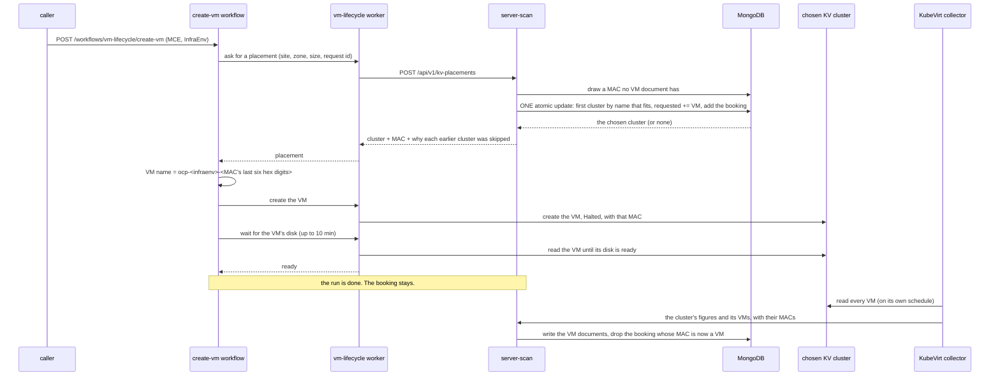

# How a new VM picks its KubeVirt cluster — through server-scan

**Status: PROPOSAL for team review, 2026-11-08. Nothing here is implemented yet.**
Revised the same day: server-scan keeps **no document per VM** (the VMs' documents come from
the KubeVirt collector only) and **server-scan allocates the VM's MAC address** (section 6).

This page explains, end to end, how create-vm will choose the KubeVirt cluster (KV cluster) a
new VM is created on, and the VM's MAC address, once server-scan owns those choices. It covers
the MongoDB documents server-scan keeps, the rule that decides whether a VM fits, how the MAC is
picked, and what happens when many VMs are requested at the same moment. Please review it before
the implementation starts.

---

## 1. Why we are changing it

Today the vm-lifecycle worker reads every KV cluster of the zone at the moment a create-vm run
starts, ranks them, and picks one. Each run does this on its own, and nothing coordinates two
runs.

So when ten create-vm runs start at once, all ten read the same picture, and all ten pick the
same cluster, even when that cluster only has room for two. This does not need a `count=10`
request: ten separate requests, or several MCEs of one site sharing a zone, cause the same thing.

## 2. The idea in one paragraph

server-scan keeps **one MongoDB document per KV cluster**, saying how big the cluster is and how
much of it is already spoken for. At the start of a create-vm run, the workflow asks server-scan
for two things: **a cluster and a MAC address**. server-scan goes through the zone's clusters
**in alphabetical order** (`-a`, then `-b`, …) and books the VM on the **first one where it still
fits**, with a MAC that no VM and no other booking uses. The check and the booking are **one
atomic database operation on the cluster's document**, so two requests can never both take the
last space on a cluster, or the same MAC. server-scan never writes a document for the VM itself:
the **KubeVirt collector** finds the VM after it is created and writes its document, exactly as
the bare-metal collectors do for servers.

---

## 3. Words used on this page

| word | meaning |
| --- | --- |
| **KV cluster** | A KubeVirt hosted cluster where our VMs run, e.g. `ocp4-kubevirt-site1-zone-a-a`. Several per zone. |
| **zone** | A part of a site's data centre. Each zone has its own set of KV clusters. |
| **request** | What a pod asks the Kubernetes scheduler for (CPU and memory). The scheduler only places a pod on a node with that much left. |
| **allocatable** | How much CPU and memory the cluster's usable nodes (Ready, not cordoned) offer to pods. |
| **requested** | How much of the allocatable is already spoken for. |
| **buffer** | The share of each cluster we always keep free, e.g. 30%. It is the room live migration needs when a node is drained. |
| **node headroom** | On one node: allocatable minus the requests of the pods running on it. |
| **booking** | server-scan's note that one VM is on its way to one KV cluster, with the MAC it was given. A line inside the cluster's document, not a document of its own. It lives only until the collector sees the VM. |
| **KubeVirt collector** | A separate job (not part of this plan) that reads every VM on every KV cluster and keeps server-scan's VM documents up to date, as the bare-metal collectors do for servers. |
| **Halted VM** | A VM that exists but is not running. create-vm always creates VMs Halted; they are started later, when a host is installed from them. A Halted VM has no pod yet. |

---

## 4. How big a VM is, in the scheduler's terms

An InfraEnv's name says the VM size: `x201-zone-a-32` means 32 vCPUs and `32 × 8` = 256 GiB.
The VM template (`vm.yaml`) turns that into what the VM's pod requests from the scheduler:

- **CPU request** = vCPU × 15 / 16, rounded down, at least 1 core
- **memory request** = guest memory + 1 GiB for KubeVirt's own overhead

| VM (vCPU / memory) | CPU request | memory request |
| --- | --- | --- |
| 8 / 64 GiB | 7 cores | 65 GiB |
| 16 / 128 GiB | 15 cores | 129 GiB |
| 32 / 256 GiB | 30 cores | 257 GiB |
| 64 / 512 GiB | 60 cores | 513 GiB |

Every number below is in these request terms, never in vCPUs.

**We check memory as well as CPU, although memory always follows CPU.** The CPU request is
discounted (15/16) and the memory request gets 1 GiB added, so a VM asks for about 8.5 GiB per
requested core. On a node with 8 GiB per core, memory runs out first. Example, a 64-core,
512 GiB node:

| VMs of 32 vCPU on the node | CPU requested | memory requested | fits? |
| --- | --- | --- | --- |
| 1 | 30 of 64 | 257 of 512 GiB | yes |
| 2 | 60 of 64 | 514 of 512 GiB | **no** — memory, not CPU |

A CPU-only check would book the second VM, which would then never start.

---

## 5. What server-scan stores

### 5.1 `kv_clusters` — one document per KV cluster

```json
{
  "_id": "ocp4-kubevirt-site1-zone-a-a",
  "site": "site1",
  "zone": "a",
  "cluster_name": "kubevirt-site1-zone-a-a",

  "allocatable_cpu_millicores": 100000,
  "allocatable_memory_bytes": 1099511627776,

  "requested_cpu_millicores": 30000,
  "requested_memory_bytes": 275951648768,

  "max_node_cpu_headroom_millicores": 50000,
  "max_node_memory_headroom_bytes": 549755813888,

  "bookings": [
    {
      "mac": "02:a1:b2:3f:9a:1c",
      "request_id": "8c1e0f6a-5b7d-4e1a-9f0e-2a4b6c8d0e1f-1",
      "holder": "create-vm",
      "workflow_id": "create-vm-ocp4-prod-mce-site1-a_x201-zone-a-32_1",
      "cpu": 32,
      "memory_gib": 256,
      "cpu_millicores": 30000,
      "memory_bytes": 275951648768,
      "created_at": "2026-11-08T09:05:12Z",
      "expires_at": "2026-11-08T11:05:12Z"
    }
  ],

  "observed_at": "2026-11-08T09:00:00Z",
  "revision": 13,
  "updated_at": "2026-11-08T09:05:12Z"
}
```

| field | what it holds | who writes it |
| --- | --- | --- |
| `_id` | The cluster's name. Clusters of a zone are tried in **alphabetical order of this name**. | the collector |
| `site`, `zone` | Which zone the cluster belongs to. A placement only looks at its own site and zone. | the collector |
| `cluster_name` | The name used in the cluster's URLs (the vm-lifecycle worker reaches the cluster's VM API through it). | the collector |
| `allocatable_cpu_millicores`, `allocatable_memory_bytes` | The total the usable nodes offer. Above: 100 cores, 1024 GiB. | the collector |
| `requested_cpu_millicores`, `requested_memory_bytes` | **Everything already spoken for**: the requests of running and pending pods, PLUS our Halted VMs (no pod yet, but they will start), PLUS the bookings the collector has not seen as VMs yet. **This is the only number a placement changes.** | the collector sets it; each booking adds to it; a release takes back |
| `max_node_cpu_headroom_millicores`, `max_node_memory_headroom_bytes` | The most room left on any single node. Above: 50 cores and 512 GiB. Used only to check that **at least one node can hold the VM**. A placement never changes it. | the collector |
| `bookings` | The VMs on their way to this cluster: created (or about to be) but not yet seen by the collector. Each one says the MAC it was given, who booked it, and its request. | each placement adds one; a release or the collector removes it |
| `observed_at` | When the collector last read the cluster. A cluster never observed, or not observed for too long, is skipped. | the collector |
| `revision`, `updated_at` | Bookkeeping, so the collector's write and a placement never overwrite each other. | server-scan |

All CPU is in millicores (1 core = 1000) and all memory in bytes, so the database compares whole
numbers only.

**Fill** is simply `requested / allocatable`. The example cluster held nothing before the one
booking above; with it, it is 30% full on CPU (30 of 100 cores).

### 5.2 Why a booking must exist at all, and why it is not a VM document

The workflow never writes a VM document, and neither does server-scan: the collector finds the
VM after it is created and writes its document, as it does for every other VM. But server-scan
must **remember the booking until then**, for two reasons:

1. **The next collector reading would erase it.** The collector rebuilds `requested` from what
   it saw on the cluster. If it read the cluster a second before the VM was created, the new VM
   is not in its figures. Without the booking, that write puts the cluster back to "30 cores
   emptier than it really is", and the next ten requests overbook it.
2. **Two requests could get the same MAC.** The MAC is checked against the VMs the collector
   has reported and against the other bookings. A MAC handed out a second ago belongs to a VM
   the collector cannot have seen yet, so only the booking tells the next request it is taken.

So a booking is short-lived bookkeeping, not inventory. It is a line inside the cluster's
document, written by the **same** atomic operation that adds the VM's request to the cluster.
That keeps it to one write: there is no moment where the cores are counted and the booking is
missing, or the other way round.

### 5.3 The VMs themselves — the collector's documents

The KubeVirt collector keeps one document per VM, with at least its name, **its MAC**, its KV
cluster, site and zone. server-scan reads these only to know which MACs are already in use.
Their exact shape belongs to the collector's own design.

---

## 6. The MAC address: who sets it, and why we set it ourselves

### 6.1 What KubeVirt does on its own

- **Plain KubeVirt:** an interface without a `macAddress` gets one when the VM **starts**. It is
  not written into the VM object, so it can change on the next start.
- **OpenShift Virtualization adds KubeMacPool**, a webhook that runs when a VM is **created**. It
  gives every interface without a `macAddress` one from a pool **of that cluster**, and writes it
  into the VM object, so it is set in advance and survives restarts. A VM that brings its own
  `macAddress` is checked against the MACs that cluster already uses and refused if taken. We have
  seen this on the platform lab: a second create with the same MAC failed with `failed to allocate
  requested mac address` (`redbull-platform/docs/lab-kubevirt-bmh-enrollment/README.md`). The
  day2 KubeVirt bare-metal test already relies on the MAC being in the VM spec right after the
  create (`gitops-day2-prod/kv-baremetal-test.md`).
- No KubeMacPool range is configured in redbull-platform or the day2 repo, so as far as we know
  each KV cluster runs the default: a range its network-addons operator picks by itself. Where
  the KV clusters' OpenShift Virtualization settings live is still to be checked.

So yes, with KubeMacPool the MAC is set in advance, at creation. But KubeMacPool knows **one
cluster**. It cannot see the other KV clusters of the zone, so it cannot promise that two VMs on
two clusters never share a MAC.

### 6.2 Why server-scan picks it

- **Unique across every KV cluster.** server-scan is the only place that sees every VM (through
  the collector's documents) and every booking. It checks a new MAC against **all** of them, not
  only the zone's.
- **The VM's name carries the MAC.** A VM is named `ocp-<infraenv>-<last six hex digits of its
  MAC>`, so the name is known before the create and name and MAC agree by construction. Letting
  KubeMacPool choose would mean creating the VM before knowing its name.
- **The BareMetalHost needs the boot MAC**, and a fixed one never changes under it.

KubeMacPool stays on, as a second guard on each cluster: if a MAC we pick is somehow already used
there (a VM created by hand that the collector has not reported yet), the create is refused rather
than making a duplicate.

### 6.3 How server-scan picks it

- Every MAC starts with one fixed, locally administered prefix (a server-scan setting,
  `INVENTORY_KV_VM_MAC_PREFIX`, e.g. `02:a1:b2`); server-scan draws the last three bytes at random.
- It drops a draw that any collector VM document already has, then tries the booking. The booking
  itself refuses a MAC that any other booking holds (a unique index on the bookings' MACs across
  all cluster documents). A refused draw is drawn again, a few times at most.
- The workflow no longer draws anything: it gets the MAC back and builds the VM's name from it.

---

## 7. The fit rule

A VM fits on a cluster when ALL of these hold:

1. **CPU stays under the buffer:** `(requested CPU + VM's CPU) / allocatable CPU <= 1 − buffer`
2. **Memory stays under the buffer:** the same, for memory
3. **One node can hold it:** `max_node_cpu_headroom >= VM's CPU` and `max_node_memory_headroom >= VM's memory`
4. **The cluster has been observed recently** by the collector

With a 30% buffer, the example cluster can hold up to 70 cores and about 717 GiB of requests.

- The buffer applies to the **whole cluster**, never to a single node. Nodes may fill completely;
  the free 30% is spread over the cluster, ready for live migration.
- server-scan **does not choose a node**. The VM is created Halted; when it is started, the
  Kubernetes scheduler chooses the node, packing the fullest node it fits on. Check 3 only makes
  sure such a node exists.
- The buffer is a server-scan setting (`INVENTORY_KV_HEADROOM_BUFFER_PERCENT`, default 30).
  It is applied when a placement is asked for and is stored nowhere, so changing it applies at once.

---

## 8. The flow, end to end



Step by step:

1. **A caller asks for a VM.** `POST /workflows/vm-lifecycle/create-vm` with the MCE and the
   InfraEnv, for example `ocp4-prod-mce-site1-a` and `x201-zone-a-32`. The site comes from the
   MCE's name, the zone and the size from the InfraEnv's name.
2. **The workflow asks server-scan for a placement.** It sends the site, zone, size, its own
   workflow id, and a **request id** unique to this run (section 9 says why).
3. **server-scan picks a MAC** under its prefix that no VM document has (section 6.3).
4. **server-scan books the first cluster that fits.** One database operation takes the zone's
   clusters sorted by name, finds the first one where the fit rule of section 7 holds, adds the
   VM's request to that cluster's `requested`, and adds the booking with the MAC, all at once.
   If another booking already holds that MAC, the operation is refused and server-scan goes back
   to step 3 with a new MAC.
5. **server-scan answers** with the chosen cluster, the MAC and, for every cluster before it, why
   it was skipped.
6. **No cluster fits?** server-scan answers 404 with the same table. The run fails, saying which
   cluster was skipped for which reason. Nothing was created and nothing was booked.
7. **The workflow names the VM** `ocp-x201-zone-a-32-3f9a1c` from the MAC `02:a1:b2:3f:9a:1c`,
   and **creates it** on the chosen cluster, Halted, with that MAC.
8. **The workflow waits up to 10 minutes** for the VM's disk to be ready.
9. **Done.** The run completes. The booking is NOT released: the VM now really exists and takes
   up its space. The workflow writes nothing more to server-scan.
10. **Later, the collector** reads the cluster, sees the VM with its MAC, and reports it.
    server-scan writes the VM's document, drops the booking with that MAC, and the cluster's
    `requested` now counts the VM as a Halted VM instead of as a booking.

---

## 9. Example: ten VMs at the same moment

Ten create-vm runs start together, each asking for a 32-vCPU VM (30 cores) in site1, zone a.
The zone has five clusters, `-a` to `-e`. Each has 100 cores allocatable and nothing requested,
so with the 30% buffer each can take up to 70 cores. (Memory is not the limit in this example.)

The database applies updates to one document one at a time, so the ten requests are handled in
the order they reach it. "Request 1" below is whichever arrives first.

| request | tries | result | `-a` | `-b` | `-c` | `-d` | `-e` |
| --- | --- | --- | --- | --- | --- | --- | --- |
| start | | | 0 | 0 | 0 | 0 | 0 |
| 1 | `-a`: 0 + 30 = 30 ≤ 70 | **`-a`** | 30 | 0 | 0 | 0 | 0 |
| 2 | `-a`: 30 + 30 = 60 ≤ 70 | **`-a`** | 60 | 0 | 0 | 0 | 0 |
| 3 | `-a`: 60 + 30 = 90 > 70, skip; `-b`: 30 | **`-b`** | 60 | 30 | 0 | 0 | 0 |
| 4 | `-a` full; `-b`: 60 | **`-b`** | 60 | 60 | 0 | 0 | 0 |
| 5–6 | `-a`, `-b` full | **`-c`** | 60 | 60 | 60 | 0 | 0 |
| 7–8 | | **`-d`** | 60 | 60 | 60 | 60 | 0 |
| 9–10 | | **`-e`** | 60 | 60 | 60 | 60 | 60 |
| 11 | every cluster: 60 + 30 = 90 > 70 | **no capacity** | 60 | 60 | 60 | 60 | 60 |

No cluster ever goes past its 70 cores, `-a` is full before anything lands on `-b`, and the ten
VMs have ten different MACs.

There is no lock that requests wait on and no retry loop. "Is there still room?" and "take it"
are one operation, so a request can never read an old number and then write on top of a newer one.

What the first caller gets back:

```json
{
  "mac": "02:a1:b2:3f:9a:1c",
  "kv_cluster": { "name": "ocp4-kubevirt-site1-zone-a-a", "cluster_name": "kubevirt-site1-zone-a-a", "site": "site1", "zone": "a" },
  "cpu_fill_after": 0.3,
  "memory_fill_after": 0.25,
  "buffer_percent": 30,
  "expires_at": "2026-11-08T11:05:12Z",
  "created": true,
  "considered": [
    { "name": "ocp4-kubevirt-site1-zone-a-a", "fits": true }
  ]
}
```

What the 11th caller gets back:

```json
{
  "status": 404,
  "code": "NO_KV_CAPACITY",
  "detail": "no KV cluster of site1 zone a fits a VM of 32 vCPU / 256 GiB under the 30% buffer",
  "details": {
    "considered": [
      { "name": "ocp4-kubevirt-site1-zone-a-a", "fits": false, "reason": "fit-buffer", "cpu_fill_after": 0.9 },
      { "name": "ocp4-kubevirt-site1-zone-a-b", "fits": false, "reason": "fit-buffer", "cpu_fill_after": 0.9 },
      { "name": "ocp4-kubevirt-site1-zone-a-c", "fits": false, "reason": "fit-buffer", "cpu_fill_after": 0.9 },
      { "name": "ocp4-kubevirt-site1-zone-a-d", "fits": false, "reason": "fit-buffer", "cpu_fill_after": 0.9 },
      { "name": "ocp4-kubevirt-site1-zone-a-e", "fits": false, "reason": "fit-buffer", "cpu_fill_after": 0.9 }
    ]
  }
}
```

The reasons a cluster can be skipped:

| reason | meaning |
| --- | --- |
| `fit-buffer` | The VM would push the cluster past the buffer, on CPU or memory. |
| `fit-node` | No single node has room for the VM. |
| `not-observed` | The collector has never read this cluster. |
| `stale` | The collector has not read it recently enough to trust the numbers. |

---

## 10. When things go wrong

| what happens | what the design does |
| --- | --- |
| The worker dies right after server-scan answered | Temporal retries the same request with the same request id. server-scan finds the booking that request already made and returns it, same cluster and same MAC, counting nothing twice. |
| Why a request id, not the workflow id | create-vm's workflow ids are slots that are reused once a run ends. A new run on the same slot, while the previous run's booking still waits for the collector, would otherwise be handed the previous VM's MAC, and "create" a VM that already exists. The request id is the run's own id plus a counter, so it is never reused. |
| The VM's disk is not ready within 10 minutes | The workflow deletes the VM, then **releases** the booking: one operation removes it from the cluster's document and takes its request off `requested`. |
| The cluster refuses the VM (a VM of that name or MAC is already there, the collector has not reported it yet) | The workflow releases the booking and asks again with the next request id, getting a new MAC (at most three times). |
| A release is sent twice | The second one finds no booking and changes nothing. |
| A run dies and never releases | The booking expires after 2 hours, and the next collector reading removes it and stops counting it. |
| The collector writes while a placement is happening | Both writes check the document's `revision`; the collector re-reads and tries again, so it never wipes out a fresh booking. |
| Two requests draw the same MAC at the same moment | The unique index lets only one booking hold it; the other draws again. |
| A zone has no cluster in server-scan at all | The run fails at once with "no KV cluster", never hangs. |

Because the booking and the cores are written by one operation, there is no "crashed between
counting the cores and saving the booking" case to clean up.

---

## 11. The collector (built later, not part of this plan)

The KubeVirt collector will read each KV cluster on a schedule and send server-scan, per cluster:

- the allocatable CPU and memory of its usable nodes,
- the requested CPU and memory: pod requests on those nodes plus our Halted VMs,
- the most headroom on any single node,
- every VM on it, with its name and MAC.

server-scan then:

1. writes or updates the VM documents,
2. drops every booking whose MAC is now one of the cluster's VMs, and every expired one,
3. sets `requested` = what the collector reported + the bookings still left,
4. saves the cluster document, retrying if a placement changed it in the meantime.

Step 3 also corrects anything that drifted, such as a VM deleted by hand. The numbers are rebuilt
from reality on every reading.

**Until the collector exists**, clusters are registered by hand with `PUT /api/v1/kv-clusters/{name}`,
sending the same figures the collector would.

---

## 12. The new server-scan API

| route | who may call | what it does |
| --- | --- | --- |
| `POST /api/v1/kv-placements` | admin | Book a cluster and a MAC for a VM (sections 8 and 9). |
| `DELETE /api/v1/kv-placements/{mac}` | admin | Release a booking. Only the run that made it can release it. |
| `GET /api/v1/kv-placements?site=&zone=&kv_cluster=` | any role | List the bookings still waiting for the collector, for operators. |
| `GET /api/v1/kv-clusters?site=&zone=` and `GET /api/v1/kv-clusters/{name}` | any role | The clusters in fill order, with their fill. |
| `PUT /api/v1/kv-clusters/{name}` | admin | Register or update a cluster's figures and VMs (the collector, or an operator by hand). |
| `DELETE /api/v1/kv-clusters/{name}` | admin | Remove a cluster; refused while bookings point at it. |

---

## 13. What changes compared to today

| | today | proposed |
| --- | --- | --- |
| Who decides the cluster | each create-vm run, alone | server-scan, for every run |
| Order | best fit: the cluster that ends up fullest | alphabetical: fill `-a`, then `-b`, … |
| Two runs at once | can pick the same cluster and overbook it | cannot: one atomic booking per request |
| Who picks the MAC | the workflow draws it, checked against the zone's VMs as the agents report them | server-scan, checked against every VM it knows and every booking |
| Who writes the VM's document | nobody (no VM documents) | the KubeVirt collector only |
| Where the numbers come from | each run reads every KV cluster live | the collector reads them on a schedule into MongoDB |
| Which clusters exist | the day1 repo's seed folder | server-scan's `kv_clusters` documents |
| The buffer setting | in the vm-lifecycle worker | in server-scan |
| What the vm-lifecycle worker still talks to | day1 git, kv-capacity agent, kv-vm-api | server-scan, kv-vm-api |

---

## 14. Known limit

**Halted VMs are on no node, so the "one node can hold it" check cannot see them.** Ten nodes of
64 cores and 512 GiB can really run ten 32-vCPU VMs, one per node (section 4). But a 30% buffer
on that cluster admits thirteen, because the node headroom does not drop when a Halted VM is
booked. The extra three would be created and then fail to start. Today's design has the same
gap. This proposal accepts it; closing it would need per-node bookkeeping in every placement.

---

## 15. Open questions for the team

1. **Cluster names.** Are KV clusters named `ocp4-kubevirt-<site>-zone-<zone>-<index>` with a
   LETTER index (`-a`, `-b`)? The workflows repo today assumes `ocp4-kubevirt-<site>-<zone>…`.
   A number index would have to be zero-padded, or `-10` would be filled before `-2`.
2. **Booking lifetime.** Is 2 hours enough? It must cover the time from creating the VM until
   the collector first sees it.
3. **Collector schedule.** How often should it run, and after how long without a reading should a
   cluster be skipped as stale? The faster it runs, the shorter bookings live.
4. **Before the collector exists.** Who registers clusters by hand, and when?
5. **The buffer.** Is 30% the right default, the same for every zone?
6. **The known limit** in section 14: acceptable for now?
7. **KubeMacPool's range.** Our MAC prefix must stay outside every KV cluster's KubeMacPool range,
   or KubeMacPool could give one of our MACs to a VM someone creates without a MAC. Today each
   cluster uses a range its network-addons operator picked by itself. Should the platform pin
   each cluster's range away from our prefix? (Labelling our VM namespace out of KubeMacPool
   would also avoid the clash, but it switches KubeMacPool off there completely, so it would no
   longer refuse a duplicate MAC either, and we would lose the second guard of section 6.2.)
8. **The collector's VM documents.** Do they go into server-scan's existing servers collection
   (kubevirt-redfish already presents each VM as a Redfish system) or a collection of their own?
   Either way they must carry the MAC.
